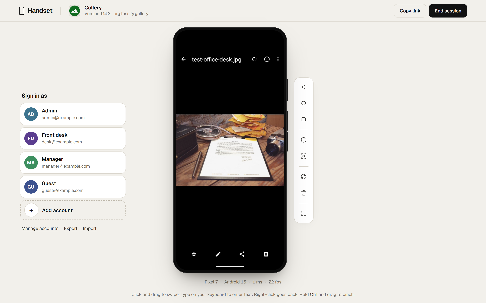
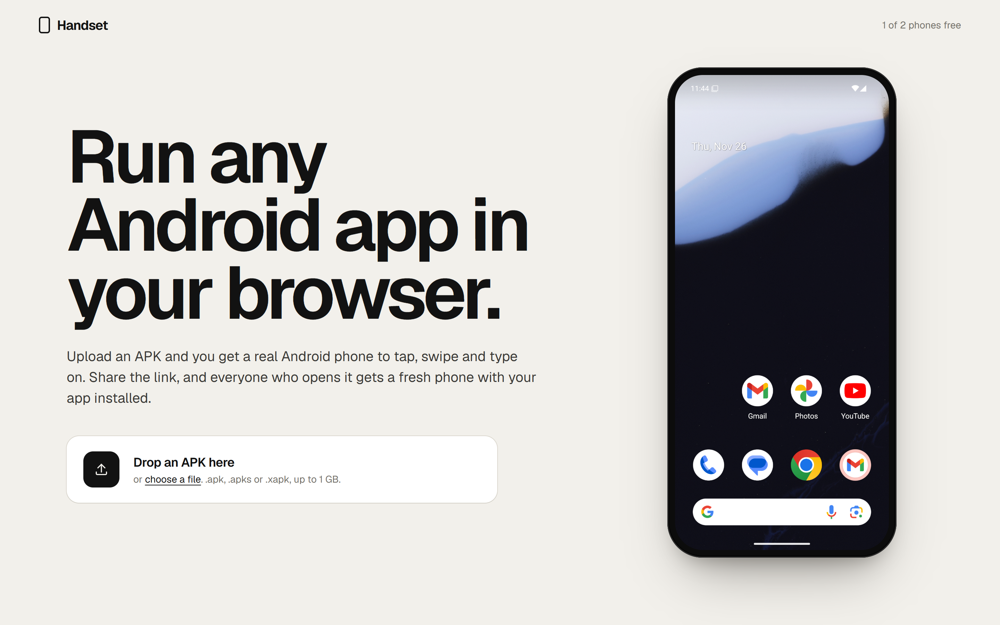
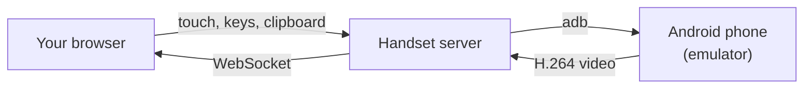

<div align="center">


# Handset

**Upload an Android app. Use it in your browser, on a real phone.**

Tap, swipe, type and switch test accounts in one click.<br>
Everyone who opens the link gets their own fresh phone.

<br>



</div>

<br>

## What it does

- **Real Android, in a tab.** Upload an `.apk`, `.apks` or `.xapk` and it opens on an Android 15 phone in the browser. Swipes, flings, long-press, pinch and Android's own gestures all work.
- **A link anyone can open.** Share `/app/<id>`. Every visitor gets a fresh phone with your app installed, and it is wiped when they leave.
- **Test accounts in one click.** Save a login for each role (Admin, Front desk…). Visitors switch between them without ever seeing a password.
- **Light on your computer.** Phones nobody is looking at are frozen (0% CPU), and crashed phones are replaced on their own.

<br>

## Get started

You need Node.js 18+, the Android SDK and about 16 GB of RAM. [Details below](#what-you-need).

```bash
git clone https://github.com/Aaryan-Saini/handset.git
cd handset
npm install
npm run setup     # once, 5–10 min: builds a clean phone to start from
npm start         # → http://localhost:3000
```

Open **[localhost:3000](http://localhost:3000)**, drop in an APK, and your app opens on a phone.



Each person runs their own copy. Your apps, accounts and phones stay on your computer, in `data/`, which is never committed.

<br>

## Using it

**Controls.** Everything works with a mouse, and touch screens work natively.

| | |
| --- | --- |
| Tap, swipe, fling | Click, or click and drag |
| Pinch | Hold `Ctrl` and drag |
| Back | Right-click or `Esc` |
| Home | Middle-click, or swipe up from the bottom edge |
| Type | Just type. `Ctrl+V` pastes into the phone, and text copied on the phone lands on your clipboard |

The bar beside the phone has back, home, recent apps, rotate, screenshot, restart app, clear app data and full screen.

**Test accounts.** Click **+ Add account** beside the phone, give it a name, username and password, then switch roles with one click. Handset signs out, reopens the app, taps through intro screens and fills the sign-in form for you. After the first time, switching back to an account takes a few seconds. Drag accounts to reorder them, and use **Export / Import** to move them between computers. Accounts can be changed on the computer Handset runs on, or in the browser that uploaded the app. Visitors from elsewhere only get the one-click list.

<br>

## How it works



- **Phones** are Android emulators that start read-only from one clean snapshot in 15–30 seconds, so every visitor gets the same fresh phone and nothing is kept.
- **Video** comes from [scrcpy](https://github.com/Genymobile/scrcpy) on the phone and is decoded in the browser with WebCodecs. Each browser gets exactly the size it shows, and late frames are dropped so lag never builds up.
- **Sign-in** uses Android's accessibility layer to read the screen and fill fields, the way a password manager does.

<br>

## What you need

- **Hardware virtualization.** On Windows, turn it on in the BIOS and enable *Windows Features → Windows Hypervisor Platform*. On Linux you need KVM. On a Mac there's nothing to do.
- **Memory.** About 5 GB per phone in use, so 16 GB or more is best. On 8 GB, run one phone at a time (`MAX_DEVICES=1`, `WARM_DEVICES=0`).
- **Disk.** About 15 GB for the Android SDK and the phone snapshot.
- **Node.js 18 or newer.**
- **Android SDK** with platform-tools, the emulator, build-tools and an Android 15 *Google APIs* image. The easiest way is [Android Studio](https://developer.android.com/studio) → *Settings → Android SDK*. With the command-line tools:

  ```bash
  sdkmanager "platform-tools" "emulator" "build-tools;35.0.0" "system-images;android-35;google_apis;x86_64"
  ```

  On an Apple silicon Mac use `system-images;android-35;google_apis;arm64-v8a`. Handset finds the SDK in its usual place, or set `ANDROID_HOME`.

<br>

## Settings

Everything works out of the box. To change something, put it in `data/settings.json` (stays on your computer), for example `{ "WARM_DEVICES": 0 }`, or set it as an environment variable. Then restart.

<details>
<summary><b>All settings</b></summary>
<br>

| Setting | Default | What it does |
| --- | --- | --- |
| `PORT` | `3000` | Web address port |
| `MAX_DEVICES` | `2` | Phones that may run at once (about 5 GB of RAM each) |
| `WARM_DEVICES` | `1` | Spare phones kept ready, so a new visitor gets a phone in ~2.5 s instead of ~25 s. Frozen while waiting (`FREEZE_SPARE`) |
| `SESSION_MINUTES` | `0` | Maximum session length. `0` means no limit |
| `IDLE_SECONDS` | `120` | Shut a phone down this long after its tab closes |
| `PAUSE_HIDDEN_SECONDS` | `30` | Freeze a phone whose tab is in the background this long |
| `MAX_SESSIONS_PER_IP` | `2` | Phones per visitor |
| `MAX_UPLOAD_MB` | `1024` | Largest upload |
| `VIDEO_MAX_SIZE` / `VIDEO_MIN_SIZE` | `1024` / `640` | Stream size limits (long edge, px) |
| `VIDEO_BITRATE` | `8000000` | Video bitrate |
| `GRANT_PERMISSIONS` | `false` | Grant every permission at install, skipping permission prompts |
| `FAST_FILL` | `true` | Fill sign-in fields instantly, falling back to typing |
| `LOCAL_ADMIN` | `true` | Anyone on the computer Handset runs on can manage every app's accounts |
| `GUEST_ANGLE` | `true` | Apps draw through ANGLE inside the phone (smoother, and avoids a renderer that crashed phones) |
| `PHONE_WIFI` | `false` | Phones go online over mobile data, which stays connected after a phone wakes up |
| `KEEP_PHONES_ON_RESTART` | `true` | Phones and sessions survive a server restart |
| `TRUST_PROXY` | unset | Set when behind a reverse proxy |
| `ANDROID_HOME` | auto | Android SDK location |

</details>

<details>
<summary><b>Letting other people use it</b></summary>
<br>

Browsers only decode video on `https://` pages (or `localhost`), so other people need an HTTPS address. The quickest way:

```bash
cloudflared tunnel --url http://localhost:3000
```

For a permanent setup, put it behind a TLS reverse proxy (Caddy, nginx) with WebSocket support and set `TRUST_PROXY=1`. For more than a couple of phones at once, use a Linux server with KVM. Anyone with the address can upload an app and get a phone with internet access, so add a login in front of a public address.

</details>

<details>
<summary><b>Phone setup, graphics and crashes</b></summary>
<br>

- `npm start` keeps the server running and restarts it if it stops. Phones keep running across restarts. Stop everything with `Ctrl+C`, then `npm run stop-phones`.
- `npm run setup -- --force` rebuilds the phone snapshot. Setup tries your graphics card first and falls back to software drawing at 720×1600, which keeps app layouts identical. Force a mode with `--gpu=host` or `--gpu=swiftshader`. `--avd=<name>` builds into a separate profile while phones are running, and Handset switches to it on its next restart.
- If a phone crashes, its session moves to a fresh phone with the same app, and the crash is logged in `data/logs/crashes.log`. On Windows, run `scripts\enable-crash-dumps.ps1` once as administrator to also record where it crashed.

</details>

<details>
<summary><b>Limits</b></summary>
<br>

- Android only. iOS apps can't run outside Apple's simulator on a Mac.
- No sound yet.
- `.aab` files must be turned into an APK or `.apks` first (bundletool). OBB files in `.xapk` are ignored.
- The phones are emulators with Google APIs but no Play Store, and no camera. Apps that refuse emulators or need the Play Store behave as they would on any emulator.

</details>

<details>
<summary><b>Project layout</b></summary>
<br>

```text
server/index.js      web server, routes, WebSocket
server/pool.js       phones: start, hand out, freeze, wake, replace
server/sessions.js   one visitor's phone: install, launch, stream, sign in
server/autologin.js  reads the screen and fills sign-in forms
server/scrcpy.js     video stream and touch/keyboard input
server/apk.js        reads app name, icon and package from uploads
server/store.js      uploaded apps and their test accounts (data/apps/)
server/crashinfo.js  explains phone crashes
public/              home page and phone page
scripts/setup.js     builds the clean phone snapshot
vendor/              scrcpy-server, accessibility helper, test photos
```

</details>

<br>

<sub>Built on [scrcpy](https://github.com/Genymobile/scrcpy) (Apache 2.0) and the [Appium UiAutomator2 server](https://github.com/appium/appium-uiautomator2-server) (Apache 2.0). Test photos are public domain (CC0, see `vendor/test-media/CREDITS.md`). The screenshot shows [Fossify Gallery](https://github.com/FossifyOrg/Gallery).</sub>
