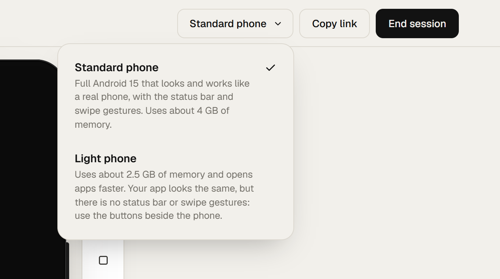
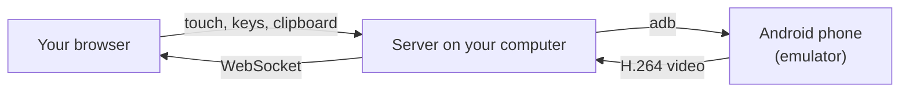

<div align="center">


# Android Emulator Online

**Run any Android app (APK) in your browser, on a real Android phone.**

Upload an APK, get a link, and anyone who opens it can tap, swipe and type on a fresh Android 15 phone in their browser.<br>
Free and self-hosted: it runs on your own computer, with one-click test accounts for every role in your app.

[Quick start](#quick-start) · [Features](#features) · [How it compares](#how-it-compares) · [FAQ](#faq)

<br>


</div>

<br>

## Why

Getting someone to try an Android app is clumsy. You send an APK they have to sideload, ask them to install Android Studio, or pay a cloud service by the minute. Android Emulator Online turns one computer into a small device lab instead: upload the app once, share a link, and every person who opens it gets their own phone, wiped clean when they leave.

## Features

### Feels like a real phone

- Real Android 15 on a Pixel 7 screen. Tap, swipe, fling, long-press and pinch, with Android's own gestures.
- Smooth scrolling with a mouse wheel or trackpad. The wheel drives a virtual finger instead of jumping in steps, and frames are shown at an even pace.
- Type on your keyboard. Copy and paste works in both directions between your computer and the phone.
- Rotate, take full-resolution screenshots, restart or clear the app, go full screen.

### Built for testing apps with several roles

- **One-click test accounts.** Save a login for each role (Admin, Front desk, Guest…), then switch between them with one click. Visitors never see the passwords.
- **Automatic sign-in.** It signs the app out, reopens it, taps through intro and permission screens, fills the sign-in form and presses the app's own button. If the app shows an error, you see it.
- **Fast switching.** After the first sign-in, switching back to an account restores it in about 4 seconds.
- Drag accounts to reorder them, and export or import them as a file.

### Easy to share

- Every app gets a link. Each visitor gets a fresh phone with the app installed, and it is wiped when they leave.
- Works in any modern browser on any device, from a cheap laptop to a phone: the visitor's device only shows a video.

### Light on the computer that runs it

- **Standard or Light phone**, chosen per session. A Light phone uses about 2.5 GB of memory instead of about 4 GB and opens apps faster.
- A frozen spare phone is kept ready, so a new visitor gets a phone in about 2.5 seconds while the spare uses no CPU.
- Phones nobody is watching are frozen (0% CPU). A crashed phone is replaced on its own, with the app reinstalled.
- Phones and sessions survive a server restart: visitors reconnect automatically.

<p align="center"></p>

## Who it's for

- **QA and testers** checking each role of an app without juggling logins or devices.
- **Agencies and freelancers** showing clients a work-in-progress build with just a link.
- **Product, design and support teams** who need to see the app as a user sees it, without Android Studio.
- **Sales and demos**: a live app in the browser, ready on any screen.

## How it compares

| | Android Emulator Online | Appetize | Android Studio emulator | BrowserStack App Live |
| --- | --- | --- | --- | --- |
| Runs on | Your own computer or server | Their cloud | Your computer | Their cloud |
| Cost | Free | Paid plans, small free tier | Free | Paid, free trial |
| Share a link to the app | Yes | Yes | No | Team accounts |
| One-click test accounts per role | Yes | No | No | No |
| Your app and logins stay on your machine | Yes | No | Yes | No |
| iOS apps | No | Yes | No | Yes |
| Real physical devices | No, emulators | No, emulators | No, emulators | Yes |

## Quick start

You need Node.js 18+, the Android SDK and hardware virtualization. [Full requirements](#requirements).

```bash
git clone https://github.com/Aaryan-Saini/android-emulator-online.git
cd android-emulator-online
npm install
npm run setup     # once, 5–10 minutes: builds the clean phone every session starts from
npm start         # open http://localhost:3000
```

Drop an APK on the page and it opens on a phone. Copy the link to share it.


Each person who clones this runs their own copy. Uploaded apps, saved accounts and phone data stay in `data/` on your computer and are never committed.

## Requirements

| | Minimum | Recommended |
| --- | --- | --- |
| CPU | 4 cores with virtualization (Intel VT-x or AMD-V) | 6 cores or more |
| Memory | 8 GB, for one Light phone (estimated) | 16 GB or more |
| Disk | 15 GB free | An SSD |
| System | Windows 10/11, Linux with KVM, or macOS | |

- **Virtualization** must be switched on. Windows: enable it in the BIOS, then *Windows Features → Windows Hypervisor Platform*. Linux: KVM (`/dev/kvm`). macOS: nothing to do.
- **Android SDK** with platform-tools, the emulator, build-tools and an Android 15 *Google APIs* image. The easiest way is [Android Studio](https://developer.android.com/studio) → *Settings → Android SDK*, or with the command-line tools:

  ```bash
  sdkmanager "platform-tools" "emulator" "build-tools;35.0.0" "system-images;android-35;google_apis;x86_64"
  ```

  On an Apple silicon Mac use `system-images;android-35;google_apis;arm64-v8a`. The SDK is found in its usual place, or set `ANDROID_HOME`.
- No graphics card is needed: phones are drawn on the CPU.

## Performance

Measured on an Intel i5-9500 (6 cores) with 32 GB of RAM, no GPU acceleration, one phone in use:

| | Standard phone | Light phone |
| --- | --- | --- |
| Memory per phone | 3.9 GB | 2.5 GB |
| App start (a Flutter app) | about 2 s | about 1.1 s |
| New visitor gets a phone (frozen spare ready) | about 2.5 s | |
| Switch to an account signed in before | about 4 s | |
| Scrolling a list, typical frame | about 22 ms | |
| Phone nobody is watching | 0% CPU, frozen | |

Two phones busy at the same time on 6 cores roughly triples frame times, so on a machine like this one phone at a time (`MAX_DEVICES=1`) feels best.

## How it works



- **Phones** are Android emulators that start read-only from one clean snapshot, so every visitor gets the same fresh phone and nothing is kept.
- **Video** comes from [scrcpy](https://github.com/Genymobile/scrcpy) on the phone and is decoded in the browser with WebCodecs. Each browser gets exactly the size it shows, and late frames are dropped so lag never builds up.
- **Sign-in** reads the screen through Android's accessibility layer and fills fields the way a password manager does, checking each value before pressing the button.
- **Apps draw through ANGLE** inside the phone (OpenGL ES turned into Vulkan), which avoids a software renderer that crashed phones and makes apps smoother.

## Using it

| Action | How |
| --- | --- |
| Tap, swipe, fling | Click, or click and drag |
| Scroll | Mouse wheel or trackpad |
| Pinch | Hold `Ctrl` and drag |
| Back | Right-click or `Esc` |
| Home | Middle-click, or the buttons beside the phone |
| Type | Just type. `Ctrl+V` pastes into the phone, and text copied on the phone lands on your clipboard |

**Test accounts.** Click **+ Add account** beside the phone, give it a name, a username and a password, then switch roles with one click. Accounts can be changed on the computer this runs on, or in the browser that uploaded the app; visitors from elsewhere only get the one-click list.

**Standard or Light phone.** Pick it in the page header; your browser remembers the choice. A Light phone has no status bar or swipe gestures, so Back and Home use the buttons beside the phone.

## Share it beyond your computer

Browsers only decode video on `https://` pages (or `localhost`), so other people need an HTTPS address. The quickest way:

```bash
cloudflared tunnel --url http://localhost:3000
```

For a permanent setup, put it behind a TLS reverse proxy (Caddy, nginx) with WebSocket support and set `TRUST_PROXY=1`. Anyone with the address can upload an app and get a phone with internet access, so put a login in front of a public address. For many phones at once, run it on a Linux server with KVM.

## FAQ

**Is it really free?**
Yes. It runs on your own computer or server, so there is no per-minute billing.

**Can it run iOS apps?**
No. iOS apps can only run in Apple's simulator on a Mac.

**Do I need a graphics card?**
No. Phones are drawn on the CPU, which is why a few fast cores matter more than a GPU.

**Can people on other devices use it?**
Yes. Their device only needs a modern browser; all the work happens on the computer that runs this. Share it over HTTPS (see above).

**Is my data safe?**
Uploaded apps and saved accounts stay in `data/` on your computer. Every phone is wiped when its session ends, and visitors never see account passwords.

**Does the phone have the Play Store?**
No. Phones use Google's *Google APIs* image, so apps that use Google sign-in, Maps or notifications work, but there is no Play Store.

**How many phones can I run?**
About 4 GB of memory per Standard phone and 2.5 GB per Light phone, plus CPU: on 6 cores, one busy phone at a time feels best.

**Can I upload an `.aab`?**
Convert it to an APK or a universal `.apks` with bundletool first. `.apk`, `.apks` and `.xapk` work directly.

**Does it have sound?**
Not yet.

<details>
<summary><b>Troubleshooting</b></summary>
<br>

- **The app says it is offline.** Phones go online through your computer's internet. Standard phones use mobile data and Light phones use Wi-Fi, and a phone that wakes from a freeze is only handed back once its internet works. If it persists, end the session and open the app again.
- **Phones are slow.** Check that virtualization is on, run one phone at a time (`MAX_DEVICES=1`), and close heavy programs. On Windows, run `scripts\defender-exclusions.ps1` once as administrator so Defender stops scanning every file the emulator touches.
- **The phone screen stays black in another browser.** It is not on `https://` or `localhost`, so the browser will not decode video. Use the tunnel above.
- **A phone crashed.** The session moves to a fresh phone with the same app on its own, and the crash is written to `data/logs/crashes.log`. On Windows, `scripts\enable-crash-dumps.ps1` (as administrator, once) also records where it crashed.
- **Setup fails to boot a phone.** Virtualization is usually off, or the Android 15 image is missing. `npm run setup -- --force` tries again from scratch.

</details>

<details>
<summary><b>All settings</b></summary>
<br>

Put them in `data/settings.json` (it stays on your computer), for example `{ "MAX_DEVICES": 1 }`, or set them as environment variables. Then restart.

| Setting | Default | What it does |
| --- | --- | --- |
| `PORT` | `3000` | Web address port |
| `MAX_DEVICES` | `2` | Phones that may run at once |
| `WARM_DEVICES` | `1` | Spare phones kept ready (frozen while they wait, see `FREEZE_SPARE`) |
| `DEFAULT_PHONE` | `standard` | Kind of phone visitors get unless they choose, and the kind kept as a spare |
| `SESSION_MINUTES` | `0` | Maximum session length. `0` means no limit |
| `IDLE_SECONDS` | `120` | Shut a phone down this long after its tab closes |
| `PAUSE_HIDDEN_SECONDS` | `60` | A phone whose tab is in the background keeps running this long, then is frozen |
| `MAX_SESSIONS_PER_IP` | `2` | Phones per visitor |
| `MAX_UPLOAD_MB` | `1024` | Largest upload |
| `VIDEO_MAX_SIZE` / `VIDEO_MIN_SIZE` | `1024` / `640` | Stream size limits (long edge, px). `720` is smoother on slower machines |
| `VIDEO_BITRATE` | `8000000` | Video bitrate |
| `GRANT_PERMISSIONS` | `false` | Grant every permission at install, skipping permission prompts |
| `FAST_FILL` | `true` | Fill sign-in fields instantly, falling back to typing |
| `LOCAL_ADMIN` | `true` | Anyone on the computer this runs on can manage every app's accounts |
| `GUEST_ANGLE` | `true` | Apps draw through ANGLE inside the phone |
| `PHONE_WIFI` | `false` | Standard phones go online over mobile data, which stays connected after a phone wakes up |
| `KEEP_PHONES_ON_RESTART` | `true` | Phones and sessions survive a server restart |
| `TRUST_PROXY` | unset | Set when behind a reverse proxy |
| `ANDROID_HOME` | auto | Android SDK location |

</details>

<details>
<summary><b>Phone setup and Light phones</b></summary>
<br>

- `npm start` keeps the server running and restarts it if it stops. Phones keep running across restarts. Stop everything with `Ctrl+C`, then `npm run stop-phones`.
- `npm run setup -- --force` rebuilds the phone snapshot. Phones are 464×1024 (the largest size the video is ever sent at) with the same app layout as a Pixel 7, 3 GB of memory and 3 cores. Options: `--gpu=host|swiftshader`, `--screen=WxH@dpi`, `--ram=MB`, `--cores=N`, `--api=LEVEL`, `--tag=IMAGE`, `--avd=NAME` (build a separate profile while phones are running), `--no-switch`.
- **Add Light phones** (Google's slim ATD test image): `sdkmanager "system-images;android-35;google_atd;x86_64"`, then `npm run setup -- --tag=google_atd --ram=2048 --avd=handset-light --as=light --no-switch`. Visitors then see the Standard/Light choice in the page header.

</details>

<details>
<summary><b>Project layout</b></summary>
<br>

```text
server/index.js      web server, routes, WebSocket
server/pool.js       phones: start, hand out, freeze, wake, replace
server/sessions.js   one visitor's phone: install, launch, stream, sign in
server/autologin.js  reads the screen and fills sign-in forms
server/scrcpy.js     video stream and touch/keyboard input
server/apk.js        reads app name, icon and package from uploads
server/store.js      uploaded apps and their test accounts (data/apps/)
server/crashinfo.js  explains phone crashes
public/              home page and phone page
scripts/setup.js     builds the clean phone snapshot
vendor/              scrcpy-server, accessibility helper, test photos
```

</details>

<br>

<sub>Built on [scrcpy](https://github.com/Genymobile/scrcpy) (Apache 2.0) and the [Appium UiAutomator2 server](https://github.com/appium/appium-uiautomator2-server) (Apache 2.0). Test photos are public domain (CC0, see `vendor/test-media/CREDITS.md`). The screenshot shows [Fossify Gallery](https://github.com/FossifyOrg/Gallery). Appetize, BrowserStack and Android Studio are trademarks of their owners.</sub>
